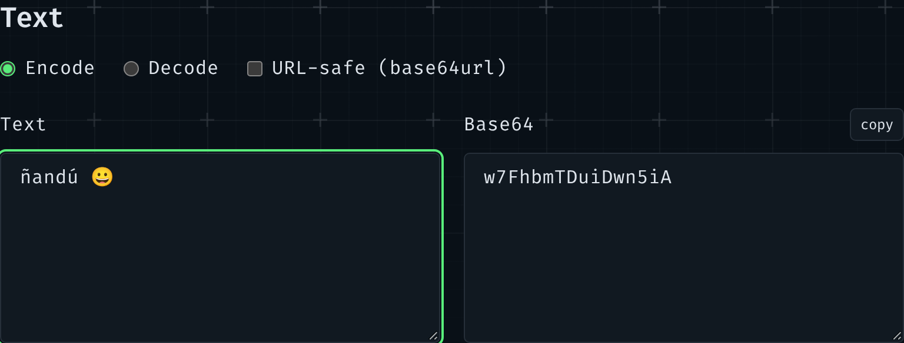

La primera herramienta de mi nueva caja de herramientas convierte texto a Base64 y vuelta. Parece una sola línea, `btoa(text)`, hasta que escribes una "ñ".



## Qué es Base64

Base64 escribe **bytes** con 64 caracteres seguros: `A–Z`, `a–z`, `0–9`, `+` y `/`. Cada 3 bytes se convierten en 4 caracteres, así que el resultado es un tercio más grande, y `=` rellena el final cuando los bytes no son múltiplo de 3. Existe para llevar datos binarios por sitios que solo aceptan texto: el correo, JSON, un `url()` de CSS.

La palabra importante es _bytes_. El texto no es bytes hasta que eliges una codificación, y en la web esa es UTF-8, donde "ñ" son dos bytes (`C3 B1`) y "😀" son cuatro.

## Por qué `btoa()` se equivoca

`btoa()` es anterior a UTF-8 en la web. No recibe texto: recibe una "cadena binaria", donde cada carácter representa un byte, códigos del 0 al 255. Así que:

```js
btoa('ñ'); // '8Q=='  (un byte, F1: "ñ" en Latin-1, no en UTF-8)
btoa('😀'); // InvalidCharacterError: fuera de 0–255
```

El primero es peor que el error: es una respuesta válida a otra pregunta. Decodifica `8Q==` como UTF-8 en cualquier otro sitio y no te devuelve "ñ".

## Texto → bytes → Base64

La solución es crear los bytes tú con `TextEncoder` (siempre UTF-8) y luego convertir cada byte en un carácter para `btoa()`:

```ts
export function encodeText(text: string): string {
	const bytes = new TextEncoder().encode(text);
	let binary = '';
	for (let i = 0; i < bytes.length; i += 0x8000) {
		binary += String.fromCharCode(...bytes.subarray(i, i + 0x8000));
	}
	return btoa(binary);
}
```

El bucle va por trozos porque `String.fromCharCode(...bytes)` pasa cada byte como argumento, y una entrada grande supera el límite de argumentos del motor.

Los navegadores ya tienen un atajo, `Uint8Array.prototype.toBase64()`, que se salta la cadena binaria. Node 22 y 24 todavía no lo tienen, y mis tests unitarios corren en Node, así que toca el camino largo.

## Bytes → texto, y dos errores distintos

Decodificar deshace el mismo camino: `atob()` da la cadena binaria, cada carácter se convierte en un byte y `TextDecoder` los lee como UTF-8. Pueden fallar dos cosas, y significan cosas distintas:

1. **No es Base64** ("Hello!": `!` no es uno de los 64 caracteres). `atob()` lanza un error.
2. **Es Base64, pero los bytes no son texto.** Pega el principio de un PNG, `iVBORw0KGgo=`, y obtienes bytes válidos que no son UTF-8.

Por defecto, `TextDecoder` esconde el segundo caso: convierte los bytes malos en "�" y sigue. Con `fatal: true` lanza un error, y la herramienta puede decir qué ha pasado:

```ts
try {
	return { ok: true, text: new TextDecoder('utf-8', { fatal: true }).decode(bytes) };
} catch {
	return { ok: false, problem: 'text' };
}
```

## Perdonar lo que se pega

El Base64 llega de muchos sitios, así que el decodificador acepta algunas variantes antes de llamar a `atob()`:

- **Espacios y saltos de línea**: el correo corta el Base64 a 76 caracteres.
- **base64url**, de los JWT y las URL: `-` y `_` en vez de `+` y `/`, y normalmente sin `=`. Se devuelve a Base64 normal, con el relleno.
- **Una data URL entera**: solo se decodifica lo que va después de `base64,`.

La herramienta también puede escribir base64url (una casilla), y al pasar de Codificar a Decodificar el resultado se convierte en la nueva entrada, así que "ñ" va y vuelve.

## Primero los tests, luego el formulario

Todo esto es TypeScript sin más en `base64.ts`, así que Vitest lo comprueba sin navegador: "ñ" es `w7E=`, "😀" es `8J+YgA==`, cada ejemplo sobrevive al viaje de ida y vuelta en los dos alfabetos, y la cabecera del PNG es "Base64, pero no texto". Después, un test de Playwright hace lo mismo con el formulario de verdad.

## Archivos: data URL

La otra mitad de la herramienta convierte un archivo en una data URL (`data:image/png;base64,…`) con `FileReader.readAsDataURL()`, que lee en segundo plano, así que la página no se congela. Los archivos tienen un límite de 2 MB: una data URL es un tercio más grande que el archivo y no se puede cachear aparte del CSS o el HTML donde está, así que es para iconos, no para fotos.

La zona para soltar archivos no tiene código de soltar. El input de archivo está estirado sobre su label y es invisible:

```css
.drop input {
	position: absolute;
	inset: 0;
	opacity: 0;
}
```

Un clic abre el selector de archivos, y un archivo soltado sobre un input de archivo cae en él de forma nativa, así que un solo manejador de `change` cubre los dos casos.

## Enlaces

- [MDN: Base64](https://developer.mozilla.org/es/docs/Glossary/Base64), con "The Unicode problem"
- [MDN: `TextDecoder` `fatal`](https://developer.mozilla.org/en-US/docs/Web/API/TextDecoder/fatal)
- [MDN: `Uint8Array.prototype.toBase64()`](https://developer.mozilla.org/en-US/docs/Web/JavaScript/Reference/Global_Objects/Uint8Array/toBase64)
- [RFC 4648 §5: base64url](https://www.rfc-editor.org/rfc/rfc4648#section-5)
- Cómo escojo qué tomar para la caja de herramientas, y qué permiten las licencias: [Tomar prestado de herramientas de código abierto: lo que pide la licencia, y lo que no](/blog/2026-11-09-what-the-mit-licence-asks)
