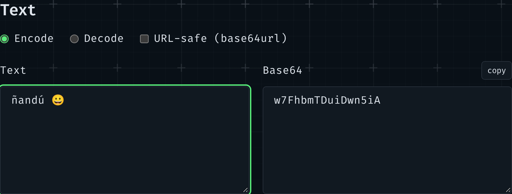

The first tool in my new toolbox converts text to Base64 and back. It looks like a one-liner, `btoa(text)`, until you type an "ñ".



## What Base64 is

Base64 writes **bytes** with 64 safe characters: `A–Z`, `a–z`, `0–9`, `+` and `/`. Every 3 bytes become 4 characters, so the result is a third bigger, and `=` pads the end when the bytes don't divide by 3. It exists to carry binary data through places that only take text: e-mail, JSON, a CSS `url()`.

The important word is _bytes_. Text isn't bytes until you pick an encoding, and on the web that's UTF-8, where "ñ" is two bytes (`C3 B1`) and "😀" is four.

## Why `btoa()` gets it wrong

`btoa()` is older than UTF-8 on the web. It doesn't take text: it takes a "binary string", where each character stands for one byte, codes 0 to 255. So:

```js
btoa('ñ'); // '8Q=='  (one byte, F1: "ñ" in Latin-1, not UTF-8)
btoa('😀'); // InvalidCharacterError: outside 0–255
```

The first one is worse than the error: it's a valid answer to a different question. Decode `8Q==` as UTF-8 anywhere else and you don't get "ñ" back.

## Text → bytes → Base64

The fix is to make the bytes yourself with `TextEncoder` (always UTF-8), then turn each byte into one character for `btoa()`:

```ts
export function encodeText(text: string): string {
	const bytes = new TextEncoder().encode(text);
	let binary = '';
	for (let i = 0; i < bytes.length; i += 0x8000) {
		binary += String.fromCharCode(...bytes.subarray(i, i + 0x8000));
	}
	return btoa(binary);
}
```

The loop works in chunks because `String.fromCharCode(...bytes)` passes every byte as an argument, and a big input goes over the engine's limit on arguments.

Browsers now have a shortcut, `Uint8Array.prototype.toBase64()`, which skips the binary string altogether. Node 22 and 24 don't have it yet, and my unit tests run in Node, so the long way it is.

## Bytes → text, and two different errors

Decoding goes back the same way: `atob()` gives the binary string, each character becomes a byte, and `TextDecoder` reads them as UTF-8. Two things can go wrong, and they mean different things:

1. **It isn't Base64** ("Hello!": `!` isn't one of the 64 characters). `atob()` throws.
2. **It's Base64, but the bytes aren't text.** Paste the start of a PNG, `iVBORw0KGgo=`, and you get valid bytes that aren't UTF-8.

By default, `TextDecoder` hides the second case: it turns bad bytes into "�" and carries on. With `fatal: true` it throws instead, and the tool can say what happened:

```ts
try {
	return { ok: true, text: new TextDecoder('utf-8', { fatal: true }).decode(bytes) };
} catch {
	return { ok: false, problem: 'text' };
}
```

## Forgiving what people paste

Base64 comes from many places, so the decoder accepts a few variants before calling `atob()`:

- **Spaces and line breaks**: e-mail wraps Base64 at 76 characters.
- **base64url**, from JWTs and URLs: `-` and `_` instead of `+` and `/`, and usually no `=`. It's put back to plain Base64, padding included.
- **A whole data URL**: only what comes after `base64,` is decoded.

The tool can also write base64url (a checkbox), and switching from Encode to Decode takes the output along as the new input, so "ñ" goes there and back.

## Tests first, then the form

All of this is plain TypeScript in `base64.ts`, so Vitest checks it without a browser: "ñ" is `w7E=`, "😀" is `8J+YgA==`, every sample survives the round trip in both alphabets, and the PNG header is "Base64, but not text". A Playwright test then does the same through the real form.

## Files: data URLs

The other half of the tool turns a file into a data URL (`data:image/png;base64,…`) with `FileReader.readAsDataURL()`, which reads in the background, so the page doesn't freeze. Files are capped at 2 MB: a data URL is a third bigger than the file and can't be cached apart from the CSS or HTML it sits in, so it's for icons, not photos.

The drop zone has no drop code at all. The file input is stretched over its label and made invisible:

```css
.drop input {
	position: absolute;
	inset: 0;
	opacity: 0;
}
```

A click opens the file picker, and a file dropped on a file input lands in it natively, so one `change` handler covers both.

## Links

- [MDN: Base64](https://developer.mozilla.org/en-US/docs/Glossary/Base64), including "The Unicode problem"
- [MDN: `TextDecoder` `fatal`](https://developer.mozilla.org/en-US/docs/Web/API/TextDecoder/fatal)
- [MDN: `Uint8Array.prototype.toBase64()`](https://developer.mozilla.org/en-US/docs/Web/JavaScript/Reference/Global_Objects/Uint8Array/toBase64)
- [RFC 4648 §5: base64url](https://www.rfc-editor.org/rfc/rfc4648#section-5)
- How I pick what to borrow for the toolbox, and what licences allow: [Borrowing from open-source tools: what the licence asks, and what it doesn't](/blog/2026-11-09-what-the-mit-licence-asks)
