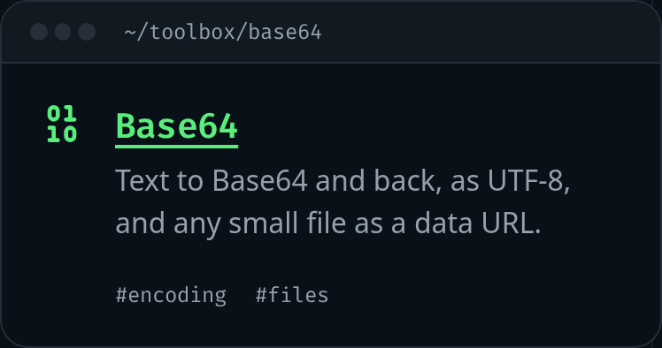

Mi sitio tiene un rincón nuevo: una **caja de herramientas** con pequeñas utilidades que funcionan en el navegador, empezando por un conversor de Base64. Las ideas salen de colecciones que me gustan, como [Omatsuri](https://github.com/rtivital/omatsuri), [it-tools](https://github.com/CorentinTh/it-tools), [DevToys](https://github.com/DevToys-app/DevToys) y [tiny-helpers](https://tiny-helpers.dev/). Escojo una herramienta aquí y otra allá y la hago en Svelte, con el estilo de mi sitio.

Coger código ajeno solo está permitido cuando su licencia lo dice. Así que, antes de tomar nada, leí las licencias.

## Cada repositorio dice qué puedes hacer con él

En GitHub, la licencia de un repositorio está en su archivo `LICENSE`, y la API también la indica:

```sh
curl -s https://api.github.com/repos/rtivital/omatsuri | grep spdx_id
# "spdx_id": "MIT",
```

Comprobé todos los proyectos de los que podría tomar algo, y quedaron en tres grupos:

- **MIT** (Omatsuri, color-color, huetone, svgomg, transform): puedes usar, copiar, cambiar y publicar el código, siempre que el aviso vaya con él.
- **Apache-2.0** (CyberChef, Squoosh, Leonardo): igual de permisiva, con un poco más de papeleo: conservar su archivo `NOTICE` y decir qué cambiaste.
- **GPL-3.0** (it-tools) y **sin licencia** (Clippy): solo ideas. it-tools es el mejor catálogo de todos, pero código GPL copiado en mi sitio pondría el código propio del sitio bajo la GPL. Y sin licencia no significa libre: significa todos los derechos reservados.

## Lo que pide la MIT a cambio

La licencia entera son tres párrafos. El primero da permiso, el último dice que no hay garantía, y el del medio es la condición:

> The above copyright notice and this permission notice shall be included in all copies or substantial portions of the Software.

La palabra clave es _copies_, copias. Si porto código de alguien, mi repositorio tiene una copia, pero también el navegador de cada visitante: la build lo mete en el JavaScript que envía el sitio. Un aviso que solo estuviera en el repositorio no viajaría con esas copias, así que tiene que estar en la página.

## La línea de crédito que quité

La primera versión de mi caja de herramientas tenía una línea discreta al final, "Herramientas basadas en Omatsuri", con la licencia MIT plegada en un `<details>`. Parecía lo correcto. Luego miré qué contenía de verdad la caja: un conversor de Base64, escrito desde cero. No comparte nada con el de Omatsuri, salvo la idea de tener uno.

Una licencia cubre código (y datos), no ideas. Un conversor de Base64 es una idea de todos. Y un crédito por código que no copié es peor que ningún crédito: dice algo falso sobre de dónde sale mi código.

Así que la línea se fue, y la regla que me quedé es más simple: **una herramienta da crédito a un proyecto cuando lleva código o datos de ese proyecto**, en esa herramienta, como pide su licencia. Hoy, ninguna lo hace.

Los datos cuentan tanto como el código. La próxima herramienta, una tabla de símbolos HTML, podría usar la lista de caracteres con nombre de la propia especificación de HTML, y esa lista también tiene licencia: el WHATWG publica sus estándares bajo CC BY 4.0, y las partes usadas en código bajo BSD 3-Clause. Las dos piden un aviso, así que, si uso esa lista, la herramienta de símbolos lo dirá.

## El código es libre; el aspecto no

Ni siquiera el código MIT viene con el nombre o el aspecto de su proyecto. Mis herramientas no cogen el logo ni el diseño de nadie: cada una es una pequeña ventana de terminal en el panel, como el resto del sitio.



## Lee antes de tomar prestado

Leer el código, no solo la licencia, compensó dos veces:

- La herramienta de Base64 de Omatsuri llama a `btoa()` con el texto tal cual, lo que lanza un error con cualquier carácter fuera de Latin-1 ("ñ", "€", todos los emojis), y con un SVG envía dos resultados. La mía funciona de otra forma: [Base64 codifica bytes, no texto](/blog/2026-11-09-base64-encodes-bytes-not-text).
- Su generador de lorem ipsum tiene dos modos más, nombres de Pokémon y frases de películas de Samuel L. Jackson. El código es MIT; los nombres y las frases no son de Omatsuri para darlos. Mi lorem ipsum será el clásico.

## Enlaces

- [choosealicense.com: MIT](https://choosealicense.com/licenses/mit/), [Apache-2.0](https://choosealicense.com/licenses/apache-2.0/), [GPL-3.0](https://choosealicense.com/licenses/gpl-3.0/)
- [GitHub Docs: licenciar un repositorio](https://docs.github.com/es/repositories/managing-your-repositorys-settings-and-features/customizing-your-repository/licensing-a-repository) (también lo que pasa sin licencia)
- [Política de propiedad intelectual del WHATWG](https://whatwg.org/ipr-policy): cómo se licencia la especificación de HTML
