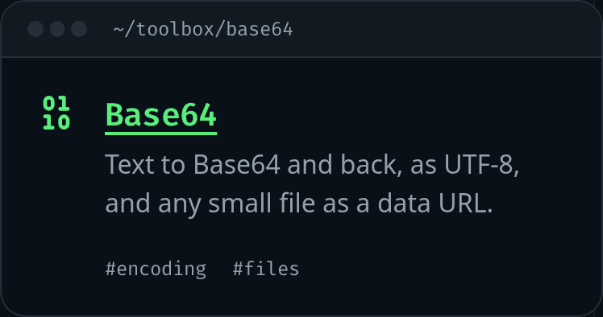

My site has a new corner: a **toolbox** of small tools that run in the browser, starting with a Base64 converter. The ideas come from collections I like, such as [Omatsuri](https://github.com/rtivital/omatsuri), [it-tools](https://github.com/CorentinTh/it-tools), [DevToys](https://github.com/DevToys-app/DevToys) and [tiny-helpers](https://tiny-helpers.dev/). I pick a tool here and there and build it in Svelte, in my site's own style.

Taking someone else's code is allowed only when its licence says so. So before borrowing anything, I read the licences.

## Every repository says what you may do with it

On GitHub, a repository's licence is in its `LICENSE` file, and the API reports it too:

```sh
curl -s https://api.github.com/repos/rtivital/omatsuri | grep spdx_id
# "spdx_id": "MIT",
```

I checked every project I might borrow from, and they fell into three groups:

- **MIT** (Omatsuri, color-color, huetone, svgomg, transform): you may use, copy, change and publish the code, as long as the notice comes along.
- **Apache-2.0** (CyberChef, Squoosh, Leonardo): just as permissive, with a little more paperwork: keep their `NOTICE` file and say what you changed.
- **GPL-3.0** (it-tools) and **no licence at all** (Clippy): ideas only. it-tools is the best catalogue of the lot, but GPL code copied into my site would put my site's own code under the GPL. And no licence doesn't mean free: it means all rights reserved.

## What MIT asks in return

The whole licence is three paragraphs. The first gives permission, the last says there's no warranty, and the middle one is the condition:

> The above copyright notice and this permission notice shall be included in all copies or substantial portions of the Software.

The key word is _copies_. If I port someone's code, my repository holds a copy, but so does every visitor's browser: the build bundles it into the JavaScript the site sends. A notice sitting only in the repository wouldn't travel with those copies, so it has to be on the page.

## The credit line I removed

My first version of the toolbox had a discreet line at the bottom, "Tools based on Omatsuri", with the MIT licence folded in a `<details>`. It looked like the right thing to do. Then I looked at what the toolbox actually contained: one Base64 converter, written from scratch. It shares nothing with Omatsuri's except the idea of having one.

A licence covers code (and data), not ideas. A Base64 converter is everyone's idea. And a credit for code I didn't copy is worse than no credit: it says something untrue about where my code comes from.

So the line went, and the rule I kept is simpler: **a tool credits a project when it ships that project's code or data**, on that tool, the way the licence asks. Today, no tool does.

Data counts as much as code. The next tool, an HTML symbols table, could use the list of named characters from the HTML spec itself, and that has a licence too: the WHATWG publishes its standards under CC BY 4.0, and parts used in code under BSD 3-Clause. Both ask for a notice, so if I use that list, the symbols tool will say so.

## The code is free; the look is not

Even MIT code doesn't come with its project's name or look. My tools don't take anyone's logo or layout: each one is a small terminal window on the dashboard, like the rest of the site.



## Read before you borrow

Reading the code, not just the licence, paid off twice:

- Omatsuri's Base64 tool calls `btoa()` on the text itself, which throws on any character outside Latin-1 ("ñ", "€", every emoji), and for an SVG it posts two results. Mine works differently: [Base64 encodes bytes, not text](/blog/2026-11-09-base64-encodes-bytes-not-text).
- Its lorem ipsum generator has two extra modes, Pokémon names and Samuel L. Jackson film quotes. The code is MIT; the names and the lines aren't Omatsuri's to give. My lorem ipsum will be the classic one.

## Links

- [choosealicense.com: MIT](https://choosealicense.com/licenses/mit/), [Apache-2.0](https://choosealicense.com/licenses/apache-2.0/), [GPL-3.0](https://choosealicense.com/licenses/gpl-3.0/)
- [GitHub Docs: Licensing a repository](https://docs.github.com/en/repositories/managing-your-repositorys-settings-and-features/customizing-your-repository/licensing-a-repository) (including what happens without one)
- [WHATWG IPR policy](https://whatwg.org/ipr-policy): how the HTML spec is licensed
